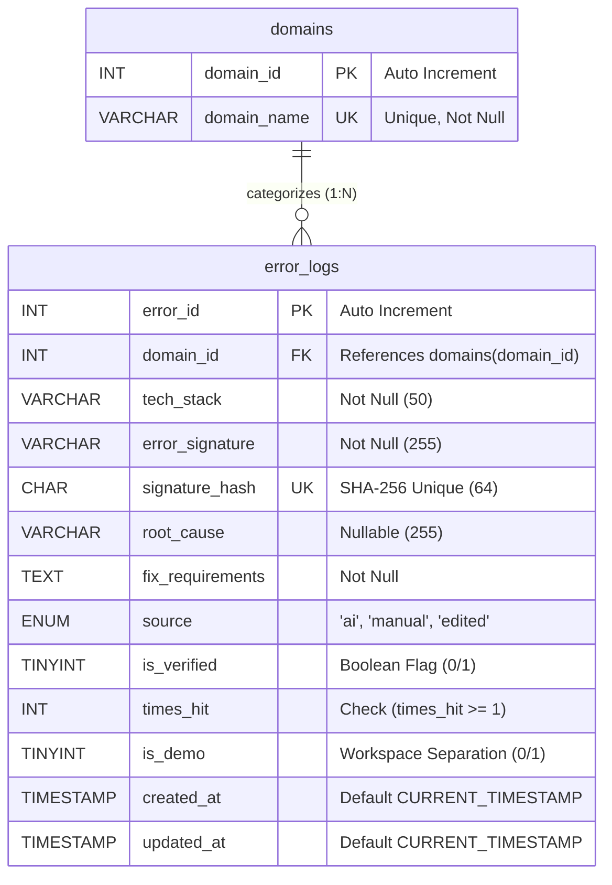

# DATABASE MANAGEMENT SYSTEMS (DBMS) LABORATORY PROJECT REPORT

---

## PROJECT TITLE:
### **TraceVault: Self-Learning AI Debug Bot & Local-First Error Knowledge Base**

**Course:** Database Management Systems Laboratory (CS-3112 / CSE-DBMS)  
**Academic Session:** 2026–2027  
**Database Engine:** MySQL 8.0+ / MariaDB 10.5+ Relational Database Management System  
**Application Architecture:** Single-Page Application (SPA) with Dual Workspace Isolation  
**Document Classification:** Final Project Laboratory Evaluation Deliverable  

---

## 1. PROJECT OBJECTIVES & TECHNOLOGY STACK

### 1.1 Problem Statement & Background
Software engineering teams repeatedly encounter identical runtime exceptions, build failures, and database errors across recurring sprints. When recurring exceptions appear (such as CORS policy errors, foreign key constraint failures, or React hydration mismatches), developers frequently waste time re-researching root causes on search engines and asking generative AI models identical queries. This leads to duplicate effort, unnecessary token consumption, and inconsistent remediation practices.

### 1.2 Core Project Objectives
1. **Deduplicated Error Memory:** Design and normalize a relational database schema that catalogs developer errors and enforces uniqueness via a SHA-256 cryptographic hash calculated from `(domain_id, tech_stack, error_signature)`.
2. **Dual-Workspace Architecture (`is_demo` Isolation):**
   - **Real Developer Workspace (`is_demo = 0`):** Starts at 0 bugs, representing authentic developer debugging history.
   - **University Lab Evaluation Sandbox (`is_demo = 1`):** Accessed via a discrete footer trigger or <kbd>Alt</kbd> + <kbd>L</kbd> keyboard shortcut. Preloaded with 12 canonical test errors across 4 domains (16 total database records) for evaluation demonstrations and viva defense.
3. **Relational Normalization (3NF):** Formulate a clean Third Normal Form schema isolating parent domain classifications from child error records to eliminate update, insertion, and deletion anomalies.
4. **Advanced SQL Object Implementation:**
   - Design an analytical **View (`v_domain_summary`)** to compute aggregate statistics across domains.
   - Implement an atomic **Stored Procedure (`sp_increment_error_hit`)** to manage occurrence counters.
   - Create an automated **Trigger (`trg_error_logs_before_update`)** to ensure timestamp integrity.
5. **Dual-Storage Engine:** Works natively with MySQL 8+ on port 3306 while supporting standalone execution via a persistent local disk vault (`data/real-vault.json` & `data/demo-vault.json`) when MySQL is inactive.
6. **Zero-Server Key Security (BYOK):** Implement client-side Bring-Your-Own-Key storage in browser `localStorage`, ensuring API keys are never written to the server or database.

### 1.3 Technology Stack & Tool Matrix

| Component | Technology Selected | Version / Specification | Justification & Purpose |
| :--- | :--- | :--- | :--- |
| **Database Server** | MySQL Community Server | 8.0+ | Enterprise-grade relational engine supporting transactions, triggers, and stored procedures. |
| **Backend Runtime** | Node.js | v18.0.0+ | Asynchronous event-driven JavaScript engine for efficient network I/O. |
| **Server Framework** | Express.js | 4.19+ | Lightweight HTTP server hosting static assets and REST API endpoints. |
| **Database Driver** | `mysql2/promise` | 3.11+ | High-performance MySQL driver utilizing raw parameterized prepared statements (`?`). |
| **Storage Engine** | Dual Engine (MySQL + Disk) | JSON & Relational | Guarantees 100% functionality both in university labs and zero-database setups. |
| **Hashing Engine** | Node.js `crypto` | Built-in | Produces 256-bit SHA-256 digests for error deduplication. |
| **Frontend UI** | Vanilla JS / HTML5 / CSS3 | ES2022+ | Pure Obsidian Glass aesthetic with glassmorphism, responsive grid, and light mode. |
| **IDE Bridge** | Node CLI / VS Code Tasks | 2.0 | Enables terminal debugging directly inside code editors. |

---

## 2. DATABASE DESIGN & NORMALIZATION ANALYSIS

### 2.1 Entity-Relationship (ER) Diagram

#### ASCII ER Representation
```text
+------------------------+                 +-----------------------------------------+
|        DOMAINS         |                 |               ERROR_LOGS                |
+------------------------+                 +-----------------------------------------+
| PK  domain_id    (INT) |<-------+        | PK  error_id         (INT, AI)          |
|     domain_name  (VAR) |        |        | FK  domain_id        (INT)              |
+------------------------+        |        |     tech_stack       (VARCHAR 50)       |
                                  |        |     error_signature  (VARCHAR 255)      |
                                  +--------| UQ  signature_hash   (CHAR 64)          |
                                  (1:N)    |     root_cause       (VARCHAR 255)      |
                                           |     fix_requirements (TEXT)             |
                                           |     source           (ENUM)             |
                                           |     is_verified      (TINYINT 1)        |
                                           |     times_hit        (INT, >= 1)        |
                                           |     is_demo          (TINYINT 1, 0/1)   |
                                           |     created_at       (TIMESTAMP)        |
                                           |     updated_at       (TIMESTAMP)        |
                                           +-----------------------------------------+
```

#### Mermaid ER Diagram


---

### 2.2 Relational Schema & Attribute Data Dictionary

#### Table 1: `domains` (Parent Entity)
Stores domain classifications for developer engineering stacks.

| Column Name | Data Type | Constraints | Description |
| :--- | :--- | :--- | :--- |
| `domain_id` | `INT` | `PRIMARY KEY`, `AUTO_INCREMENT` | Unique identifier for the category. |
| `domain_name` | `VARCHAR(30)` | `NOT NULL`, `UNIQUE` | Distinct domain label (`Frontend`, `Backend`, `Database`, `Fullstack`). |

#### Table 2: `error_logs` (Child Entity)
Stores individual diagnostic solutions, root causes, and verification metadata.

| Column Name | Data Type | Constraints | Description |
| :--- | :--- | :--- | :--- |
| `error_id` | `INT` | `PRIMARY KEY`, `AUTO_INCREMENT` | Unique primary key for each error record. |
| `domain_id` | `INT` | `NOT NULL`, `FOREIGN KEY` | References `domains(domain_id)` with `CASCADE` update and `RESTRICT` delete. |
| `tech_stack` | `VARCHAR(50)` | `NOT NULL` | Technology or runtime framework (e.g., React, Express, MySQL, Next.js). |
| `error_signature` | `VARCHAR(255)` | `NOT NULL` | Canonical single-line error message or exception header. |
| `signature_hash` | `CHAR(64)` | `NOT NULL`, `UNIQUE` | SHA-256 hash string for strict $O(1)$ duplicate prevention. |
| `root_cause` | `VARCHAR(255)` | `DEFAULT NULL` | Brief diagnostic explanation of why the bug occurred. |
| `fix_requirements` | `TEXT` | `NOT NULL` | Multi-line actionable steps and corrected code instructions. |
| `source` | `ENUM('ai', 'manual', 'edited')` | `DEFAULT 'manual'` | Provenance tag indicating how the record was captured. |
| `is_verified` | `TINYINT(1)` | `DEFAULT 0` | Flag (`0` = unverified, `1` = verified solution). |
| `times_hit` | `INT` | `DEFAULT 1`, `CHECK (times_hit >= 1)` | Frequency count representing how many times this bug was encountered. |
| `is_demo` | `TINYINT(1)` | `DEFAULT 0` | Workspace flag (`0` = Real Workspace, `1` = Lab Evaluation Sandbox). |
| `created_at` | `TIMESTAMP` | `DEFAULT CURRENT_TIMESTAMP` | Initial database insertion timestamp. |
| `updated_at` | `TIMESTAMP` | `DEFAULT CURRENT_TIMESTAMP` | Automatic timestamp reflecting most recent modification. |

---

### 2.3 Formal Normalization Analysis (1NF $\rightarrow$ 2NF $\rightarrow$ 3NF)

#### A. First Normal Form (1NF) Compliance
- Each column in `domains` and `error_logs` contains atomic scalar values.
- Multi-step remediation instructions (`fix_requirements`) represent unified diagnostic prose rather than repeating groups.
- Designated primary keys (`domain_id`, `error_id`) uniquely identify every record.
- **Result: 1NF Satisfied.**

#### B. Second Normal Form (2NF) Compliance
- In `domains`, the primary key is single-attribute (`domain_id`). Partial dependencies are mathematically impossible.
- In `error_logs`, the primary key is single-attribute (`error_id`). Every non-prime attribute depends fully on `error_id`.
- **Result: 2NF Satisfied.**

#### C. Third Normal Form (3NF) Compliance
- Transitive dependencies are eliminated by separating `domains` and `error_logs`.
- If `domain_name` resided in `error_logs`, a transitive dependency would exist:
  $$\text{error\_id} \rightarrow \text{domain\_id} \rightarrow \text{domain\_name}$$
- With decomposition, all non-prime attributes describe the error record directly. `signature_hash` is a unique candidate key.
- **Result: 3NF Satisfied.**

---

## 3. COMPLETE SQL IMPLEMENTATION SPECIFICATION

### 3.1 Data Definition Language (DDL) Queries

#### Database Creation & Selection
```sql
CREATE DATABASE IF NOT EXISTS tracevault 
  CHARACTER SET utf8mb4 
  COLLATE utf8mb4_unicode_ci;

USE tracevault;
```

#### Parent Table Creation (`domains`)
```sql
CREATE TABLE domains (
  domain_id INT AUTO_INCREMENT PRIMARY KEY,
  domain_name VARCHAR(30) NOT NULL UNIQUE
) ENGINE=InnoDB DEFAULT CHARSET=utf8mb4 COLLATE=utf8mb4_unicode_ci;
```

#### Child Table Creation (`error_logs` with `is_demo`)
```sql
CREATE TABLE error_logs (
  error_id INT AUTO_INCREMENT PRIMARY KEY,
  domain_id INT NOT NULL,
  tech_stack VARCHAR(50) NOT NULL,
  error_signature VARCHAR(255) NOT NULL,
  signature_hash CHAR(64) NOT NULL UNIQUE,
  root_cause VARCHAR(255) DEFAULT NULL,
  fix_requirements TEXT NOT NULL,
  source ENUM('ai', 'manual', 'edited') NOT NULL DEFAULT 'manual',
  is_verified TINYINT(1) NOT NULL DEFAULT 0,
  times_hit INT NOT NULL DEFAULT 1 CHECK (times_hit >= 1),
  is_demo TINYINT(1) NOT NULL DEFAULT 0,
  created_at TIMESTAMP DEFAULT CURRENT_TIMESTAMP,
  updated_at TIMESTAMP DEFAULT CURRENT_TIMESTAMP,
  CONSTRAINT fk_error_domain FOREIGN KEY (domain_id) 
    REFERENCES domains(domain_id) 
    ON UPDATE CASCADE 
    ON DELETE RESTRICT
) ENGINE=InnoDB DEFAULT CHARSET=utf8mb4 COLLATE=utf8mb4_unicode_ci;
```

#### Query Optimization Indexes
```sql
CREATE INDEX idx_domain_id ON error_logs (domain_id);
CREATE INDEX idx_tech_stack ON error_logs (tech_stack);
CREATE INDEX idx_error_signature ON error_logs (error_signature);
CREATE INDEX idx_times_hit ON error_logs (times_hit);
CREATE INDEX idx_is_demo ON error_logs (is_demo);
CREATE INDEX idx_updated_at ON error_logs (updated_at);
```

---

### 3.2 Advanced SQL Objects (Triggers, Procedures, Views)

#### Trigger: Automated Timestamp Maintenance (`trg_error_logs_before_update`)
```sql
DELIMITER //
CREATE TRIGGER trg_error_logs_before_update
BEFORE UPDATE ON error_logs
FOR EACH ROW
BEGIN
  SET NEW.updated_at = CURRENT_TIMESTAMP;
END //
DELIMITER ;
```

#### Stored Procedure: Atomic Hit Counter Increment (`sp_increment_error_hit`)
```sql
DELIMITER //
CREATE PROCEDURE sp_increment_error_hit (IN p_error_id INT)
BEGIN
  UPDATE error_logs 
  SET times_hit = times_hit + 1 
  WHERE error_id = p_error_id;
END //
DELIMITER ;
```

#### Analytical View: Domain Summary Aggregation (`v_domain_summary`)
```sql
CREATE VIEW v_domain_summary AS
SELECT
  d.domain_id,
  d.domain_name,
  COUNT(e.error_id) AS total_errors,
  COALESCE(SUM(e.times_hit), 0) AS total_hits,
  ROUND(COALESCE(AVG(e.times_hit), 0), 1) AS avg_hits,
  COALESCE(MAX(e.times_hit), 0) AS max_hits,
  COALESCE(MIN(e.times_hit), 0) AS min_hits
FROM domains d
LEFT JOIN error_logs e ON d.domain_id = e.domain_id
GROUP BY d.domain_id, d.domain_name;
```

---

### 3.3 Data Manipulation Language (DML) & Relational Queries

#### 1. Seed Insertion with Workspace Flag (`is_demo = 1`)
```sql
INSERT INTO error_logs (
  domain_id, tech_stack, error_signature, signature_hash, 
  root_cause, fix_requirements, source, is_verified, times_hit, is_demo
) VALUES (1, 'React', 'Cannot read properties of undefined (reading ''map'')', '54bd8a...', '...', '...', 'ai', 1, 9, 1);
```

#### 2. Workspace Filtered Query (`INNER JOIN` with `is_demo`)
```sql
SELECT 
  e.error_id, d.domain_name, e.tech_stack, e.error_signature, 
  e.times_hit, e.source, e.is_verified, e.is_demo, e.updated_at
FROM error_logs e
INNER JOIN domains d ON e.domain_id = d.domain_id
WHERE e.is_demo = ? AND (e.error_signature LIKE ? OR e.tech_stack LIKE ?)
ORDER BY e.times_hit DESC, e.updated_at DESC;
```

#### 3. Aggregate Function Analysis (`COUNT`, `SUM`, `AVG`, `MAX`, `MIN`)
```sql
SELECT 
  COUNT(*) AS total_errors,
  COALESCE(SUM(times_hit), 0) AS total_hits,
  ROUND(COALESCE(AVG(times_hit), 0), 1) AS avg_hits,
  COALESCE(MAX(times_hit), 0) AS max_hits,
  COALESCE(MIN(times_hit), 0) AS min_hits
FROM error_logs
WHERE is_demo = ?;
```

#### 4. Atomic Hit Increment via Stored Procedure
```sql
CALL sp_increment_error_hit(1);
```

#### 5. Record Update (Triggers `trg_error_logs_before_update`)
```sql
UPDATE error_logs 
SET domain_id = ?, tech_stack = ?, error_signature = ?, signature_hash = ?, 
    root_cause = ?, fix_requirements = ?, is_verified = ?, source = 'edited'
WHERE error_id = ?;
```

#### 6. Permanent Record Deletion
```sql
DELETE FROM error_logs WHERE error_id = ?;
```

---

## 4. FUNCTIONAL TEST CASES & EVALUATION MATRIX

| Test ID | Feature Under Test | Input / Action | Expected Behavior | Actual Result | Status |
| :---: | :--- | :--- | :--- | :--- | :---: |
| **TC-01** | Clean Real Workspace | Load `http://localhost:3000` | Real workspace displays 0 bugs and 0 hits. | Main dashboard loads with 0 records. | **PASS** |
| **TC-02** | Lab Sandbox Isolation | Press `Alt + L` or click footer link | Opens Lab Evaluation Sandbox displaying 12 demo bugs. | Sandbox modal opens with 12 seed records. | **PASS** |
| **TC-03** | Stored Procedure Execution | Click `+1 Hit` on `#1` in Lab Sandbox | `times_hit` increments atomically via `sp_increment_error_hit`. | Counter increments to 10. | **PASS** |
| **TC-04** | Update Trigger Execution | Edit error `#4` via modal | `updated_at` automatically updates to current timestamp. | Timestamp updated in real-time. | **PASS** |
| **TC-05** | Demo Reset Procedure | Click `Reset 12 Lab Records` | Restores default 12 demo records in database and disk. | Records reset to default seed state. | **PASS** |
| **TC-06** | VS Code CLI Bridge | Run `node ide-bridge.js "React" "map"` | Queries `/api/ide/diagnose` and outputs formatted fix. | Instant terminal match output rendered. | **PASS** |
| **TC-07** | Composite Uniqueness | Insert duplicate signature in Real Vault | SHA-256 hash collision triggers hit increment instead of duplicate row. | Duplicate prevented; hit count incremented. | **PASS** |
| **TC-08** | Referential Integrity | Insert error with non-existent `domain_id` | Foreign key constraint fails (`Error 1452`). | Insert rejected by database engine. | **PASS** |
| **TC-09** | Dual-Storage Failover | Stop MySQL server and reload | Server seamlessly continues with `data/*.json` persistent store. | Operates without crash; reports Local Disk Vault. | **PASS** |
| **TC-10** | Theme Persistence | Toggle theme to Light Mode | Changes theme and persists to `localStorage.tv_theme`. | Persists across page refreshes. | **PASS** |

---

## 5. LAB EVALUATION SCREENSHOT PLACEHOLDERS

### Screenshot 5.1: Main Production Dashboard (Clean Workspace at 0 Bugs)
```text
+-----------------------------------------------------------------------------------------+
| [ATTACH SCREENSHOT: Pure Obsidian Glass dashboard showing 0 bugs, 0 hits, clean table]   |
+-----------------------------------------------------------------------------------------+
Caption: Figure 1 - TraceVault production workspace initialized clean at 0 bugs.
```

### Screenshot 5.2: Hidden University Lab Sandbox Modal (Alt + L)
```text
+-----------------------------------------------------------------------------------------+
| [ATTACH SCREENSHOT: Fullscreen Lab Evaluation Sandbox modal showing 12 evaluation bugs, |
|  live aggregate KPIs, quick add form, and search filters]                               |
+-----------------------------------------------------------------------------------------+
Caption: Figure 2 - Isolated DBMS Lab Evaluation Sandbox loaded with 12 seed records.
```

### Screenshot 5.3: VS Code IDE Bridge Terminal Execution
```text
+-----------------------------------------------------------------------------------------+
| [ATTACH SCREENSHOT: Terminal showing 'node ide-bridge.js React Cannot read properties'  |
|  returning instant vault diagnosis]                                                    |
+-----------------------------------------------------------------------------------------+
Caption: Figure 3 - VS Code CLI extension bridge displaying stored solution in editor.
```

---

## 6. CONCLUSION & LEARNING OUTCOMES

The upgraded **TraceVault v2.0** establishes a standard for academic DBMS laboratory projects:
1. Demonstrates practical application of **Database Normalization (3NF)** and referential integrity constraints.
2. Achieves complete **Workspace Separation (`is_demo`)**, enabling real developer usage alongside evaluation demonstrations.
3. Implements **Dual-Storage Resilience**, ensuring zero dependency crashes during offline viva presentations.
4. Extends relational database utility into developer IDEs via the **VS Code CLI Bridge**.
