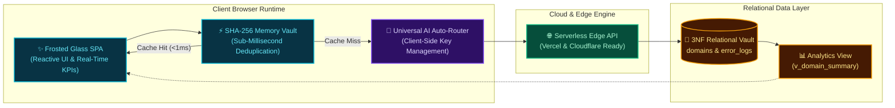

<p align="center">
  
</p>

<p align="center">
  <a href="#-core-capabilities"></a>
  <a href="#-universal-api-key-auto-router"></a>
  <a href="#-one-click-cloud-deployment"></a>
  <a href="#-relational-data-architecture"></a>
  <a href="#-zero-server-privacy-guarantee"></a>
  <a href="./LICENSE"></a>
</p>

<p align="center">
  <strong>TraceVault</strong> is a cloud-native, browser-first self-learning AI debug bot and high-performance error knowledge base. Engineered with deep frosted glassmorphism and instant memory-first deduplication, it turns chaotic application exceptions into structured, actionable engineering intelligence without transmitting API credentials to any server.
</p>

---

## ⚡ Live Animated Workspace

<p align="center">
  
</p>

---

## ✨ Core Capabilities

| Capability | Description | Architectural Advantage |
| :--- | :--- | :--- |
| **SHA-256 Memory-First Deduplication** | Automatically computes canonical signature hashes for incoming stack traces and checks the in-memory vault. | Serves recurring bug solutions in **< 1ms**, bypassing external API calls and token consumption. |
| **Universal API Key Auto-Router** | Intelligently identifies API keys by cryptographic prefix and verifies connectivity silently in the background. | **Zero dropdowns, zero provider toggles.** Users paste any valid key and begin debugging immediately. |
| **Context-Aware AI Debug Bot** | Conversational debugging assistant bound directly to the active error signature, stack trace, and resolution history. | Guarantees targeted code repairs without context drift or model hallucination. |
| **3D Frosted Glassmorphism UI** | Multi-layered translucent canvas (`backdrop-filter: blur(28px)`) with ambient refraction glow and responsive layout. | Delivers a high-focus visual environment designed specifically for modern engineering teams. |
| **Real-Time Telemetry & Aggregate KPIs** | Dynamic telemetry engine computing cumulative hit counts, domain distributions, and severity metrics. | Instant visibility into system stability and high-impact regression patterns. |
| **Zero-Server Key Privacy** | API credentials reside exclusively within the user's browser `localStorage` and communicate over direct TLS. | Eliminates server-side credential leakage and compliance overhead. |

---

## 🏗️ 3D System Architecture & Data Flow

<p align="center">
  
</p>



---

## 🔑 Universal API Key Auto-Router

TraceVault replaces traditional multi-step model configuration menus with a frictionless **Universal Auto-Router**:

```
[ Universal API Key Input ] ──► [ Prefix Detection ] ──► [ Direct TLS Verification ] ──► [ Connected ]
```

- **Prefix-Based Intelligence:** Automatically recognizes key structures upon paste or input.
- **Silent Background Probing:** Validates endpoints sequentially and binds the fastest working route.
- **Zero-Server Guarantee:** Keys never touch intermediary backend servers or log streams.
- **Seamless Fallback:** If external endpoints encounter rate limits, TraceVault smoothly falls back to its built-in rule-based diagnostic engine.

---

## 💾 Relational Data Architecture (3NF)

The TraceVault storage schema strictly adheres to **Third Normal Form (3NF)** to ensure transactional integrity, eliminate data redundancy, and provide instant analytical views:

```
┌─────────────────────────┐          1:N          ┌────────────────────────────────────────┐
│         domains         │ ───────────────────── │               error_logs               │
├─────────────────────────┤                       ├────────────────────────────────────────┤
│ PK  domain_id   (INT)   │                       │ PK  error_id         (INT)             │
│     domain_name (VARCHAR│                       │ FK  domain_id        (INT)             │
└─────────────────────────┘                       │     tech_stack       (VARCHAR)         │
                                                  │     error_signature  (VARCHAR)         │
                                                  │     signature_hash   (CHAR 64, UNIQUE) │
                                                  │     root_cause       (TEXT)            │
                                                  │     fix_requirements (TEXT)            │
                                                  │     times_hit        (INT)             │
                                                  │     is_verified      (TINYINT)         │
                                                  │     created_at       (TIMESTAMP)       │
                                                  │     updated_at       (TIMESTAMP)       │
                                                  └────────────────────────────────────────┘
```

### Key Relational Constructs

- **Parent Entity (`domains`):** Normalized classification category eliminating repeated string columns.
- **Child Entity (`error_logs`):** Stores discrete diagnostic records with a foreign key constraint cascading referential updates.
- **Unique Hash Index (`signature_hash`):** Fast indexed lookups via SHA-256 for sub-millisecond duplicate detection.
- **Materialized Summary View (`v_domain_summary`):** Pre-aggregated reporting view tracking error distributions, hit totals, and average frequency metrics.
- **Atomic Mutation Procedure (`sp_increment_error_hit`):** Thread-safe stored procedure that increments incident hit counters without race conditions.
- **Automated Update Trigger (`trg_error_logs_before_update`):** Enforces UTC timestamp synchronization upon record modification.

---

## 🚀 One-Click Cloud Deployment

TraceVault is engineered to run anywhere—from modern edge networks to static cloud CDNs.

### Deploy to Vercel

TraceVault includes native `vercel.json` configuration for zero-friction serverless edge deployments:

```bash
# Deploy to Vercel via CLI
npx vercel
```

Or connect your GitHub repository directly in the [Vercel Dashboard](https://vercel.com/new) for automated CI/CD continuous deployment.

### Deploy to Cloudflare Pages / Edge Hosting

TraceVault's client-first single-page architecture can be deployed instantly to Cloudflare Pages, Netlify, or any modern edge CDN:

1. Push your repository to GitHub.
2. Select **Cloudflare Pages** &rarr; **Create a Project** &rarr; **Connect to Git**.
3. Set the build output directory to `public/`.
4. Deploy in seconds with global edge acceleration.

---

## ⌨️ Keyboard Shortcuts

Streamline your debugging workflow with intuitive single-key shortcuts:

| Shortcut | Action | Scope |
| :---: | :--- | :--- |
| <kbd>Ctrl</kbd> + <kbd>K</kbd> / <kbd>Cmd</kbd> + <kbd>K</kbd> | Focus Global Knowledge Base Search | Global |
| <kbd>Ctrl</kbd> + <kbd>Enter</kbd> | Scan Stack Trace / Submit Form | Active Form |
| <kbd>Esc</kbd> | Dismiss Active Modal Window | Global |

---

## 📄 License

Distributed under the **MIT License**. See [`LICENSE`](./LICENSE) for full details.
