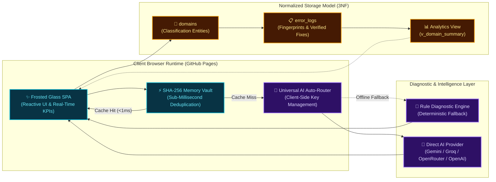

<p align="center">
  
</p>

<p align="center">
  <a href="https://mhkh361.github.io/Tracevault/"></a>
  <a href="./LICENSE"></a>
</p>

<p align="center">
  <strong>TraceVault</strong> is a high-performance, browser-first self-learning AI debug bot and error knowledge base. Engineered with deep frosted glassmorphism, instant SHA-256 memory deduplication, and zero-server client execution, it transforms chaotic runtime exceptions into structured engineering intelligence without transmitting API credentials to any intermediary server.
</p>

<p align="center">
  👉 <strong><a href="https://mhkh361.github.io/Tracevault/">Open Live Application (GitHub Pages)</a></strong>
</p>

---

## ⚡ Live Animated Workspace

<p align="center">
  
</p>

---

## ✨ Core Capabilities

| Capability | Description | Architectural Advantage |
| :--- | :--- | :--- |
| **SHA-256 Memory-First Deduplication** | Automatically computes canonical signature hashes for incoming stack traces and checks the in-memory vault. | Serves recurring bug solutions in **&lt; 1ms**, eliminating redundant API calls and token waste. |
| **Universal API Key Auto-Router** | Intelligently identifies API keys by cryptographic prefix and verifies connectivity silently in the background. | **Zero dropdowns, zero provider toggles.** Users paste any valid key and begin debugging immediately. |
| **Context-Aware AI Debug Bot** | Conversational debugging assistant bound directly to the active error signature, stack trace, and resolution history. | Guarantees targeted code repairs without context drift or model hallucination. |
| **3D Frosted Glassmorphism UI** | Multi-layered translucent canvas (`backdrop-filter: blur(28px)`) with ambient refraction glow and responsive layout. | Delivers a high-focus visual environment designed specifically for modern engineering teams. |
| **Real-Time Telemetry & Aggregate KPIs** | Dynamic telemetry engine computing cumulative hit counts, domain distributions, and severity metrics. | Instant visibility into system stability and high-impact regression patterns. |
| **Zero-Server Key Privacy Guarantee** | API credentials reside exclusively within the user's browser `localStorage` and communicate over direct TLS. | Eliminates server-side credential leakage, third-party logging, and compliance risks. |

---

## 🏗️ System Architecture & Data Flow

<p align="center">
  
</p>



---

## 🔑 Universal API Key Auto-Router

TraceVault replaces traditional multi-step model configuration menus with a frictionless **Universal Auto-Router**:

```
[ Universal API Key Input ] ──► [ Prefix Detection ] ──► [ Direct TLS Verification ] ──► [ Connected ]
```

- **Prefix-Based Intelligence:** Automatically recognizes key structures upon paste or input.
- **Silent Background Probing:** Validates endpoints sequentially and binds the fastest working route.
- **Zero-Server Guarantee:** Keys never touch intermediary backend servers or log streams.
- **Seamless Fallback:** If external endpoints encounter rate limits, TraceVault smoothly falls back to its built-in rule-based diagnostic engine.

---

## 💾 Relational Data Architecture (3NF)

The TraceVault storage schema adheres strictly to **Third Normal Form (3NF)** to ensure transactional integrity, eliminate data redundancy, and provide instant analytical views:

### Normalized Entities

#### 1. `domains` (Parent Classification Table)

| Column | Type | Constraints | Description |
| :--- | :--- | :--- | :--- |
| `domain_id` | `INT` | `PRIMARY KEY`, `AUTO_INCREMENT` | Unique identifier for the technical domain |
| `domain_name` | `VARCHAR(64)` | `NOT NULL`, `UNIQUE` | Distinct classification label (e.g., `Database`, `Auth`, `Network`) |

#### 2. `error_logs` (Child Incident & Resolution Table)

| Column | Type | Constraints | Description |
| :--- | :--- | :--- | :--- |
| `error_id` | `INT` | `PRIMARY KEY`, `AUTO_INCREMENT` | Unique incident identifier |
| `domain_id` | `INT` | `FOREIGN KEY` &rarr; `domains(domain_id)` | Normalized reference to parent domain |
| `tech_stack` | `VARCHAR(64)` | `NOT NULL` | Technology ecosystem (e.g., `Node.js / Express`, `MySQL`) |
| `error_signature` | `VARCHAR(255)` | `NOT NULL` | Canonical error message or exception header |
| `signature_hash` | `CHAR(64)` | `NOT NULL`, `UNIQUE` | SHA-256 fingerprint for sub-millisecond deduplication |
| `root_cause` | `TEXT` | `NOT NULL` | Structured technical breakdown of failure mechanism |
| `fix_requirements` | `TEXT` | `NOT NULL` | Verified remediation steps and code fix instructions |
| `times_hit` | `INT` | `DEFAULT 1` | Cumulative occurrence frequency counter |
| `is_verified` | `TINYINT(1)` | `DEFAULT 1` | Verification flag for tested solutions |
| `created_at` | `TIMESTAMP` | `DEFAULT CURRENT_TIMESTAMP` | Initial incident registration timestamp |
| `updated_at` | `TIMESTAMP` | `DEFAULT CURRENT_TIMESTAMP ON UPDATE` | Last occurrence or modification timestamp |

### Key Relational Constructs

- **Parent Entity (`domains`):** Normalized classification category eliminating repeated string columns.
- **Child Entity (`error_logs`):** Stores discrete diagnostic records with a foreign key constraint cascading referential updates.
- **Unique Hash Index (`signature_hash`):** Fast indexed lookups via SHA-256 for sub-millisecond duplicate detection.
- **Materialized Summary View (`v_domain_summary`):** Pre-aggregated reporting view tracking error distributions, hit totals, and average frequency metrics.
- **Atomic Mutation Procedure (`sp_increment_error_hit`):** Thread-safe stored procedure that increments incident hit counters without race conditions.
- **Automated Update Trigger (`trg_error_logs_before_update`):** Enforces UTC timestamp synchronization upon record modification.

---

## 🌐 Live Web App (GitHub Pages)

TraceVault is deployed as a zero-dependency standalone application on GitHub Pages:

- **Official Live Application:** [https://mhkh361.github.io/Tracevault/](https://mhkh361.github.io/Tracevault/)
- **Zero-Server Standalone Execution:** Instant sub-millisecond deduplication, client-side SHA-256 fingerprinting, and browser memory/`localStorage` persistence without requiring backend servers.
- **Client Privacy Guarantee:** API credentials and diagnostic traces remain exclusively inside your browser session and communicate over direct TLS.

---

## ⌨️ Keyboard Shortcuts

Streamline your debugging workflow with intuitive single-key shortcuts:

| Shortcut | Action | Scope |
| :---: | :--- | :--- |
| <kbd>Ctrl</kbd> + <kbd>K</kbd> / <kbd>Cmd</kbd> + <kbd>K</kbd> | Focus Global Knowledge Base Search | Global |
| <kbd>Ctrl</kbd> + <kbd>Enter</kbd> | Scan Stack Trace / Submit Form | Active Form |
| <kbd>Esc</kbd> | Dismiss Active Modal Window | Global |

---

## 📄 License

Distributed under the **MIT License**. See [`LICENSE`](./LICENSE) for full details.
