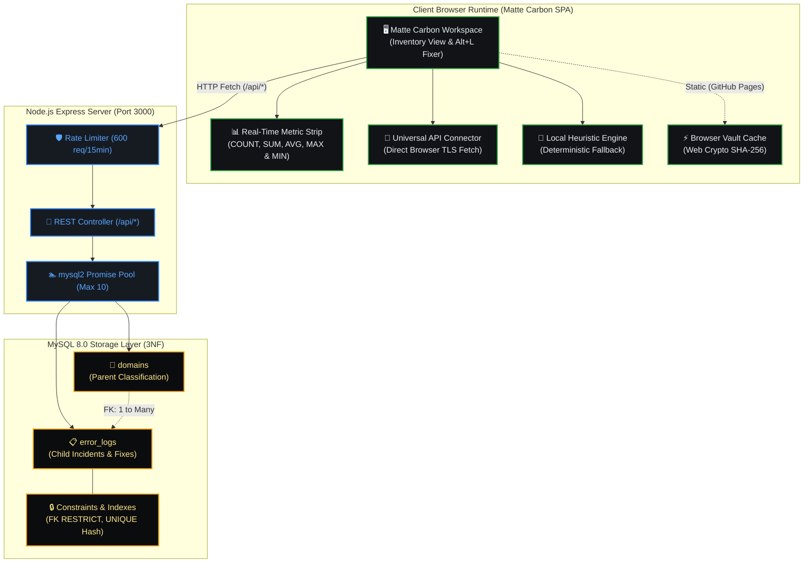

<p align="center">
  
</p>

<p align="center">
  <a href="https://mhkh361.github.io/Tracevault/"></a>
  <a href="./LICENSE"></a>
  =22" />
  
  
</p>

<p align="center">
  <strong>TraceVault</strong> is a high-performance, developer-first AI code diagnostic workbench and normalized error knowledge base. Designed with a human-crafted Matte Carbon aesthetic, instant SHA-256 fingerprint deduplication, and a brand-free Universal API Connector, it translates runtime exceptions into verified engineering fixes with zero-server credential storage.
</p>

<p align="center">
  👉 <strong><a href="https://mhkh361.github.io/Tracevault/">Launch Live Application (GitHub Pages)</a></strong>
</p>

---

## ⚡ Live Animated Workspace

<p align="center">
  
</p>

---

## 🌓 Dual-Mode Runtime Architecture

TraceVault operates seamlessly across two production deployment targets without code modifications:

| Feature / Dimension | 🏢 Full-Stack Mode (Local / Cloud Server) | 🌐 Static Mode (GitHub Pages) |
| :--- | :--- | :--- |
| **Runtime Environment** | Node.js `>=22` + Express 4.19 | Pure Static Browser Single Page App |
| **Database Engine** | MySQL 8.0 / MariaDB on Port 3306 (InnoDB) | Local Browser Vault (`localStorage` + In-Memory) |
| **Data Normalization** | 3NF Relational Schema (`domains` &rarr; `error_logs`) | Client-side 3NF Simulation & Normalized Objects |
| **Referential Integrity** | Foreign Key (`ON UPDATE CASCADE ON DELETE RESTRICT`) | Soft-delete guards and ID validation |
| **Deduplication Engine** | SHA-256 (`crypto.createHash`) + `ON DUPLICATE KEY UPDATE` | Web Crypto API (`crypto.subtle.digest`) SHA-256 |
| **API Endpoints** | REST API (`/api/health`, `/api/domains`, `/api/errors`, `/api/stats`) | Direct in-memory router with zero network latency |
| **Security & Privacy** | Rate limiting (600 req/15min) + Parameterized SQL | Direct browser-to-LLM TLS; zero server storage |

---

## 🏗️ System Architecture & Data Flow

<p align="center">
  
</p>



---

## ✨ Core Features & Technical Highlights

### 1. 📋 DBMS Lab Inventory Workspace
- **Complete Relational Table:** 8 high-density responsive columns displaying incident ID, Error Signature, Root Cause, Domain Category (FK), Tech Stack, Fix Solution, Hit Frequency, Verification State, and Actions.
- **SQL Aggregate Formula Strip:** Connected header cards reflecting live SQL aggregates:
  - `COUNT(*)`: Total cataloged incidents.
  - `SUM(times_hit)`: Cumulative hit frequency across all environments.
  - `AVG(times_hit)`: Mean occurrence rate rounded to 1 decimal place.
  - `MAX & MIN`: Dynamic spread between highest-frequency and lowest-frequency bugs.
- **Full Relational CRUD Operations:**
  - `INSERT INTO`: Modal form with foreign key dropdown selection and input validation.
  - `UPDATE ... WHERE`: Atomic edit dialog with hash collision detection.
  - `DELETE WHERE`: Safe deletion dialog guarded by foreign key referential integrity (`ON DELETE RESTRICT`).
- **Live Multi-Field Search & Filter:** Instant filtering by ID (`#1..12`), error message, tech stack, root cause, fix requirements, or domain category.

### 2. ⚡ AI Code Bug Fixer & Interactive Chat (<kbd>Alt</kbd> + <kbd>L</kbd>)
- **Full-Page Dedicated Workspace:** Seamlessly transitions from the inventory table to an expansive, non-cramped developer workbench.
- **Side-by-Side Diagnostic Workbench:**
  - **Left Panel:** Code editor with language selector (JavaScript, React/Next.js, MySQL/SQL, Python, PHP, C/C++, Java, or Auto-Detect) and 1-click sample bug presets (Express CORS, React Infinite Loop, MySQL Foreign Key, Headers Sent).
  - **Right Panel:** Auto-populated diagnostic output displaying detected Error Signature, Tech Stack, Root Cause Analysis, and Verified Patched Code.
- **1-Click Database Commit:** Single button (`💾 Save Fix to Database Table`) commits the diagnosed patch directly into the MySQL database or Browser Vault with automatic SHA-256 deduplication.
- **Expansive Gemini-Style AI Diagnostic Chat:**
  - Dedicated multi-turn conversational interface directly below the code editor.
  - Contextual awareness: automatically receives the active code snippet, detected error, and patch.
  - Quick question triggers: *"How to fix this bug step by step?"*, *"Explain root cause line by line"*, *"How to optimize & prevent future crashes?"*.
- **Deterministic Local Heuristic Fallback:** When offline or without an API key, TraceVault runs a local diagnostic parser dynamically analyzing the user's actual code lines (React 18 async `useEffect` with `AbortController`, Python `try/except` boundaries, MySQL connection pool release, Express CORS headers, and asynchronous response guards).

### 3. 🔑 Brand-Free Universal API Connector
- **Zero-Dropdown Simplicity:** Paste any valid AI key into the modal connector. TraceVault automatically identifies key formats by cryptographic prefix (`AIza...`, `gsk_...`, `sk-or-...`, `sk-...`).
- **Direct TLS Communication:** All LLM prompts are transmitted directly from the client's browser to the provider endpoint over HTTPS.
- **Zero-Server Storage:** API keys are held exclusively in the browser's local storage and never transmitted to or logged by the TraceVault backend.

### 4. 🛡️ Security & Enterprise Hardening
- **SHA-256 Deduplication:** Computes normalized canonical hashes (`LOWER(TRIM(signature))`). Duplicate error submissions atomically increment `times_hit` via `ON DUPLICATE KEY UPDATE` instead of polluting the database.
- **Express Rate Limiting:** Enforces `600 requests / 15 minutes` via `express-rate-limit` on all `/api/*` routes, preventing abuse while allowing heavy automated testing.
- **Parameterized SQL Queries:** Every MySQL query executes via prepared statements (`pool.execute(sql, params)`), completely immunizing against SQL injection vulnerabilities.
- **Automated QA Verification:** Validated via automated Puppeteer test suites covering 13 end-to-end user workflows with 0 console errors, 0 layout shifts, and 0 failed assertions.

---

## 💾 Relational Database Schema (3NF)

The database schema adheres to **Third Normal Form (3NF)** to eliminate anomalies and guarantee referential integrity.

### 1. `domains` (Parent Classification Entity)
```sql
CREATE TABLE IF NOT EXISTS domains (
  domain_id INT AUTO_INCREMENT PRIMARY KEY,
  domain_name VARCHAR(50) NOT NULL UNIQUE,
  description VARCHAR(255) NOT NULL,
  created_at TIMESTAMP DEFAULT CURRENT_TIMESTAMP
) ENGINE=InnoDB;
```

### 2. `error_logs` (Child Incident & Resolution Entity)
```sql
CREATE TABLE IF NOT EXISTS error_logs (
  error_id INT AUTO_INCREMENT PRIMARY KEY,
  domain_id INT NOT NULL,
  tech_stack VARCHAR(100) NOT NULL,
  error_signature VARCHAR(255) NOT NULL,
  signature_hash CHAR(64) NOT NULL UNIQUE,
  root_cause TEXT NOT NULL,
  fix_requirements TEXT NOT NULL,
  times_hit INT NOT NULL DEFAULT 1 CHECK (times_hit >= 1),
  is_verified TINYINT(1) NOT NULL DEFAULT 1,
  created_at TIMESTAMP DEFAULT CURRENT_TIMESTAMP,
  CONSTRAINT fk_error_domain
    FOREIGN KEY (domain_id) REFERENCES domains (domain_id)
    ON UPDATE CASCADE
    ON DELETE RESTRICT
) ENGINE=InnoDB;
```

### 📦 Seeded Lab Catalog (12 Normalized Records)

| ID | Domain (FK) | Tech Stack | Canonical Error Signature | Hits |
| :---: | :--- | :--- | :--- | :---: |
| `#1` | Frontend (1) | Fetch API / CORS | `Access to fetch at origin has been blocked by CORS policy` | 15 |
| `#2` | Frontend (1) | React 18 / Hooks | `Too many re-renders. React limits the number of renders to prevent an infinite loop` | 9 |
| `#3` | Frontend (1) | Next.js 14 / SSR | `Hydration failed because the initial UI does not match what was rendered on the server` | 7 |
| `#4` | Backend (2) | Node.js / Express | `Error [ERR_HTTP_HEADERS_SENT]: Cannot set headers after they are sent to the client` | 12 |
| `#5` | Backend (2) | Node.js / TCP | `Error: listen EADDRINUSE: address already in use :::3000` | 6 |
| `#6` | Backend (2) | Express / JSON | `SyntaxError: Unexpected token in JSON at position 0 in body-parser` | 5 |
| `#7` | Database (3) | MySQL 8.0 / InnoDB | `ER_NO_REFERENCED_ROW_2: Cannot add or update a child row: a foreign key constraint fails` | 11 |
| `#8` | Database (3) | MySQL 8.0 / SQL | `ER_DUP_ENTRY: Duplicate entry for key error_logs.signature_hash` | 4 |
| `#9` | Database (3) | mysql2 / Pool | `Error: connect ECONNREFUSED 127.0.0.1:3306` | 4 |
| `#10` | Fullstack (4) | JWT / Auth | `JsonWebTokenError: invalid signature on protected API route` | 8 |
| `#11` | Fullstack (4) | Prisma / Env | `Error: Environment variable not found: DATABASE_URL` | 2 |
| `#12` | Fullstack (4) | WebSockets / TLS | `Mixed Content: The page at HTTPS was loaded over HTTPS, but requested an insecure ws:// endpoint` | 2 |

---

## 📡 REST API Reference

When running the Node.js full-stack backend, the following endpoints are served on `http://localhost:3000`:

| Method | Endpoint | Description | Status Codes |
| :--- | :--- | :--- | :---: |
| `GET` | `/api/health` | Check MySQL connection pool health and server status | `200`, `503` |
| `GET` | `/api/domains` | Retrieve all parent domains with joined bug counts and total hits | `200`, `500` |
| `POST` | `/api/domains` | Register a new domain category (`domain_name`, `description`) | `201`, `400`, `409` |
| `DELETE` | `/api/domains/:id` | Delete an unused domain (blocked if referenced by foreign key) | `200`, `400`, `409` |
| `GET` | `/api/stats` | Compute real-time `COUNT`, `SUM`, `AVG`, `MAX`, `MIN` across records | `200`, `500` |
| `GET` | `/api/errors` | Query error records with optional `?domain_id=&search=` filters | `200`, `500` |
| `POST` | `/api/errors` | Insert or UPSERT incident record via SHA-256 deduplication | `201`, `400`, `500` |
| `PUT` | `/api/errors/:id` | Atomically update an existing incident with hash collision check | `200`, `400`, `404`, `409` |
| `DELETE` | `/api/errors/:id` | Permanently remove an error incident by ID | `200`, `400`, `404` |

---

## 🚀 Quickstart & Local Installation

### Prerequisites
- **Node.js** `>= 22.0.0`
- **MySQL** `>= 8.0` or **MariaDB** `>= 10.5` running locally on port `3306`

### 1. Clone & Install
```bash
git clone https://github.com/mhkh361/Tracevault.git
cd Tracevault
npm install
```

### 2. Configure Database Environment (Optional)
By default, TraceVault connects to `127.0.0.1:3306` with user `root` and an empty password. You can override these using environment variables or a `.env` file:
```bash
PORT=3000
DB_HOST=127.0.0.1
DB_PORT=3306
DB_USER=root
DB_PASSWORD=your_mysql_password
DB_NAME=tracevault
```

### 3. Initialize Schema & Seed Data
Execute the database initialization script to create tables and populate the 12 verified lab incidents:
```bash
npm run db:setup
```

### 4. Start Server
```bash
npm start
```
Open **`http://localhost:3000`** in your browser. The connection badge in the top right will display **`● MySQL 3306`**.

---

## ⌨️ Keyboard Shortcuts

| Shortcut | Action | Scope |
| :---: | :--- | :--- |
| <kbd>Alt</kbd> + <kbd>L</kbd> | Toggle between Database Inventory and AI Code Fixer Workspace | Global |
| <kbd>Ctrl</kbd> + <kbd>K</kbd> / <kbd>Cmd</kbd> + <kbd>K</kbd> | Focus Global Inventory Search Box | Database Inventory |
| <kbd>Esc</kbd> | Close any open modal dialog (API Key, Edit, Delete) | Global |
| <kbd>Enter</kbd> (in Chat) | Send message to AI Diagnostic Assistant | AI Chat |
| <kbd>Shift</kbd> + <kbd>Enter</kbd> | Insert newline in Chat input or Code Editor | Text Inputs |

---

## 📄 License

Distributed under the **MIT License**. See [`LICENSE`](./LICENSE) for full details.
