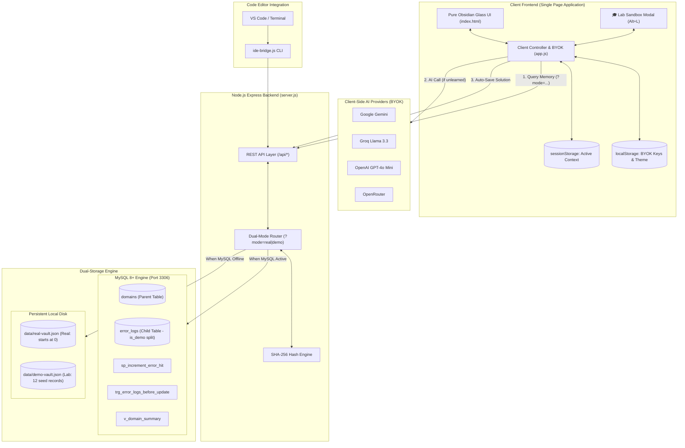
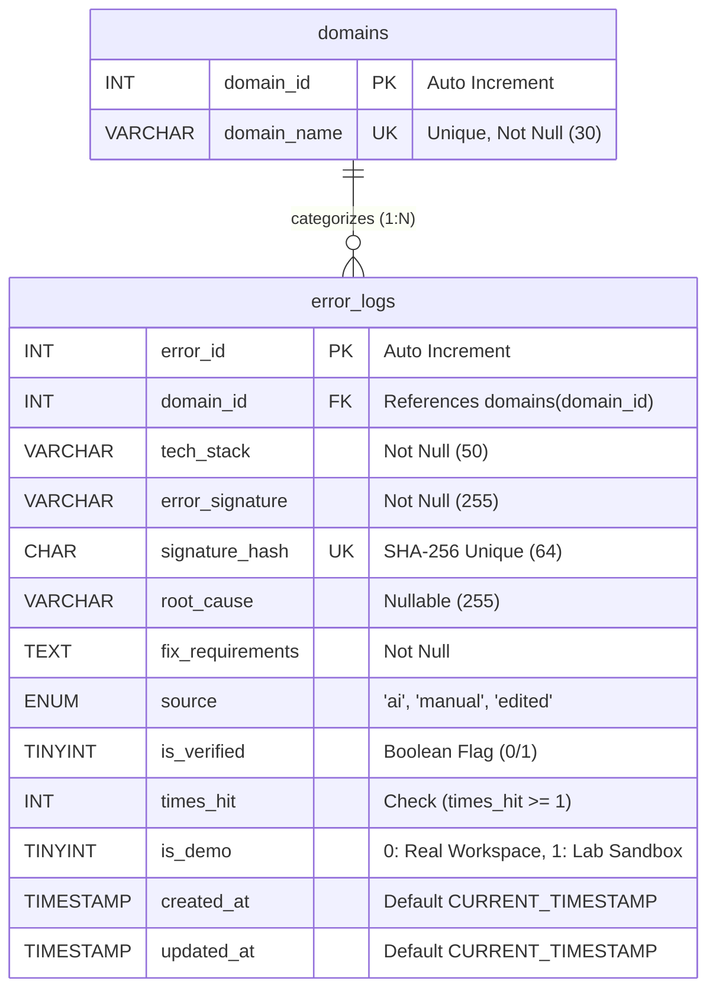

# TraceVault

> **Self-Learning AI Debug Bot & Local-First Error Knowledge Base**  
> *DBMS Laboratory Final Project & Developer Productivity Tool*

[](https://www.mysql.com/)
[](https://nodejs.org/)
[](https://expressjs.com/)
[](#database-design--normalization-3nf)
[](#byok-ai-configuration)
[](#uiux-design-system-pure-obsidian-glass)

---

## 1. Project Overview & Architecture Upgrades

**TraceVault** solves recurring developer debugging friction by combining an intelligent **Single-Page Application (SPA)** with a normalized **MySQL relational database** and **Persistent Local Disk Storage**:

1. **Pure Obsidian Glass Design System:** High-contrast obsidian dark mode default (`#000000` base, translucent `rgba(10, 10, 14, 0.78)` glass cards with `backdrop-filter: blur(16px)`, crisp borders, neon emerald/cyan highlights, and instant light-mode toggle).
2. **Clean Real Workspace (`is_demo = 0`):** The primary dashboard starts strictly clean at **0 bugs and 0 hits** on fresh setup. All KPI cards, domain pills, and table entries represent genuine developer usage.
3. **Hidden University Lab Sandbox Modal (`Alt + L`):** Triggered discreetly via footer link or <kbd>Alt</kbd> + <kbd>L</kbd>. Houses the 12 pre-seeded DBMS evaluation records (`is_demo = 1`), live aggregate KPI cards (`COUNT`, `SUM`, `AVG`, `MAX/MIN`, `Top Hit`), full-text search, CRUD forms, and a `Reset 12 Lab Records` button for lab viva demonstrations.
4. **Dual-Storage Engine:** Works seamlessly across environments:
   - **Live MySQL 8+:** Uses raw parameterized queries (`?`), B-tree indexes, stored procedures, triggers, and views.
   - **Persistent Local Disk Vault (`data/real-vault.json` & `data/demo-vault.json`):** Zero-database standalone mode using atomic filesystem persistence if MySQL is offline.
5. **VS Code & IDE Extension Bridge:** Run `node ide-bridge.js "<tech_stack>" "<error_message>"` or trigger the included VS Code task `"TraceVault: Diagnose Error"` to query solutions directly inside the editor terminal without browser context-switching.
6. **Zero-Server Key Security (BYOK):** API keys (`tv_ai_key`) are saved exclusively in browser `localStorage` and never transmitted to `server.js` or MySQL.

---

## 2. System Architecture Diagram



---

## 3. Database Design & Entity-Relationship (ER) Diagram

TraceVault adheres strictly to **Third Normal Form (3NF)** with referential integrity constraints, candidate key hashing, and query-optimized B-tree indexes.

### Relational Schema Diagram (Mermaid)



### Relational Schema Properties
- **Parent Table (`domains`):** Fixed lookup table defining the 4 core developer domains: `Frontend`, `Backend`, `Database`, and `Fullstack`.
- **Child Table (`error_logs`):** Stores deduplicated error signatures. Enforces `ON UPDATE CASCADE ON DELETE RESTRICT`. Includes `is_demo` flag and `idx_is_demo` index to isolate real developer usage from lab evaluation seed data.
- **Indexes:** `idx_domain_id`, `idx_tech_stack`, `idx_error_signature`, `idx_times_hit`, `idx_is_demo`, `idx_updated_at`.

---

## 4. Advanced SQL Database Objects

### 4.1 Trigger: `trg_error_logs_before_update`
Automatically synchronizes the `updated_at` timestamp whenever an error record is edited:
```sql
DELIMITER //
CREATE TRIGGER trg_error_logs_before_update
BEFORE UPDATE ON error_logs
FOR EACH ROW
BEGIN
  SET NEW.updated_at = CURRENT_TIMESTAMP;
END //
DELIMITER ;
```

### 4.2 Stored Procedure: `sp_increment_error_hit`
Executes an atomic hit counter increment on repeated occurrences:
```sql
DELIMITER //
CREATE PROCEDURE sp_increment_error_hit (IN p_error_id INT)
BEGIN
  UPDATE error_logs 
  SET times_hit = times_hit + 1 
  WHERE error_id = p_error_id;
END //
DELIMITER ;
```

### 4.3 Analytical View: `v_domain_summary`
Precomputes domain-level aggregate metrics:
```sql
CREATE VIEW v_domain_summary AS
SELECT
  d.domain_id,
  d.domain_name,
  COUNT(e.error_id) AS total_errors,
  COALESCE(SUM(e.times_hit), 0) AS total_hits,
  ROUND(COALESCE(AVG(e.times_hit), 0), 1) AS avg_hits,
  COALESCE(MAX(e.times_hit), 0) AS max_hits,
  COALESCE(MIN(e.times_hit), 0) AS min_hits
FROM domains d
LEFT JOIN error_logs e ON d.domain_id = e.domain_id
GROUP BY d.domain_id, d.domain_name;
```

---

## 5. Quick Start & Setup Guide

### Prerequisites
- [Node.js](https://nodejs.org/) (v18.0.0 or higher)
- Optional: [MySQL Server](https://dev.mysql.com/downloads/mysql/) (8.0+ or MariaDB 10.5+)

### Step 1: Install Dependencies
```bash
npm install
```

### Step 2: Configure Environment (Optional)
Configure `.env` if connecting to local MySQL:
```env
PORT=3000
DB_HOST=localhost
DB_PORT=3306
DB_USER=root
DB_PASSWORD=your_password
DB_NAME=tracevault
NODE_ENV=development
```
*(If MySQL is not active, TraceVault automatically runs in persistent local disk vault mode using `data/real-vault.json` and `data/demo-vault.json`).*

### Step 3: Launch TraceVault
```bash
npm start
```
Open **http://localhost:3000** in your browser.

---

## 6. VS Code IDE Extension Bridge

Diagnose errors directly from your editor terminal:

```bash
node ide-bridge.js "<tech_stack>" "<error_message>"
```

**Examples:**
```bash
node ide-bridge.js "React" "Cannot read properties of undefined (reading 'map')"
node ide-bridge.js "Node.js" "Error: listen EADDRINUSE: address already in use :::3000"
```

**Using VS Code Task:**
1. Open the Command Palette (<kbd>Ctrl</kbd>+<kbd>Shift</kbd>+<kbd>P</kbd> or <kbd>Cmd</kbd>+<kbd>Shift</kbd>+<kbd>P</kbd>).
2. Select **Tasks: Run Task** $\rightarrow$ **TraceVault: Diagnose Error**.
3. Enter the Tech Stack and paste the error trace to view the instant fix in the integrated terminal.

---

## 7. REST API Reference

All backend endpoints use parameterized SQL queries (`?`) and support workspace isolation via `?mode=real` (default) or `?mode=demo`:

| Method | Endpoint | SQL / Operation | Description |
| :--- | :--- | :--- | :--- |
| `GET` | `/api/health` | Diagnostic check | Returns health status, storage engine mode, and MySQL connection |
| `GET` | `/api/domains` | `SELECT ... FROM domains` | Returns all 4 domain categories |
| `GET` | `/api/stats?mode=...` | `COUNT()`, `SUM()`, `AVG()` | Aggregate analytics for dashboard KPI cards (real or demo) |
| `GET` | `/api/errors?mode=...`| `SELECT ... INNER JOIN` | Filtered error search with sorting |
| `POST` | `/api/errors` | `INSERT` / `CALL sp_increment_error_hit` | Log error (deduplicates via SHA-256 hash) |
| `POST` | `/api/errors/ai-upsert`| `INSERT` / `CALL` | Auto-save learned error from AI scanner |
| `PUT` | `/api/errors/:id?mode=...`| `UPDATE ... WHERE error_id = ?` | Edit error record; triggers timestamp update |
| `POST` | `/api/errors/:id/hit?mode=...`| `CALL sp_increment_error_hit(?)` | Atomic hit increment button action |
| `PATCH`| `/api/errors/:id/verify?mode=...`| `UPDATE ... SET is_verified = NOT is_verified` | Toggle verified solution badge |
| `DELETE`| `/api/errors/:id?mode=...`| `DELETE FROM error_logs WHERE error_id = ?` | Permanently deletes record with confirmation |
| `POST` | `/api/demo/reset` | `DELETE` + `INSERT` | Resets the 12 Lab Sandbox demo records to default seed data |
| `POST` | `/api/ide/diagnose` | Query real vault | VS Code CLI diagnostic bridge endpoint |
| `GET` | `/api/export?mode=...` | Stream file | Exports vault as JSON or CSV |

---

## 8. Keyboard Shortcuts

- <kbd>Ctrl</kbd> + <kbd>K</kbd> / <kbd>Cmd</kbd> + <kbd>K</kbd>: Instant focus on search input.
- <kbd>Alt</kbd> + <kbd>L</kbd>: Open/close the **University Lab Evaluation Sandbox Modal**.
- <kbd>Esc</kbd>: Dismiss active modals.

---

## 9. Security Guardrails

- All database queries strictly use parameterized statements (`?`).
- All dynamic strings sanitized against XSS via `escapeHTML()`.
- BYOK API keys stored strictly in browser `localStorage`.
- `.gitignore` protects secrets, dependencies, and `data/real-vault.json`.
